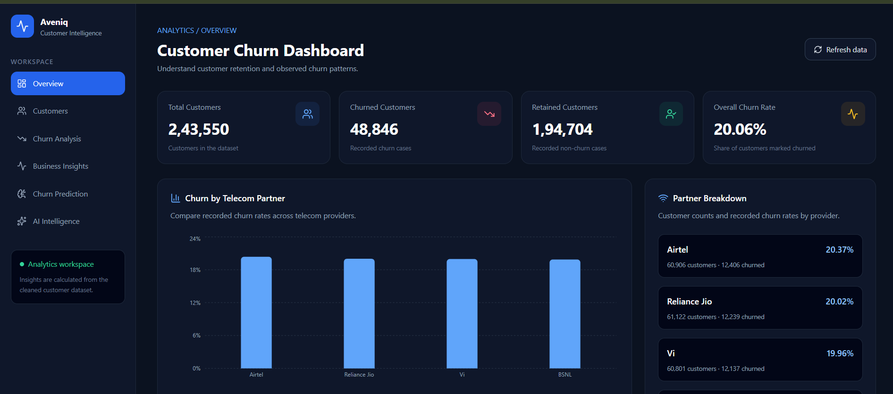
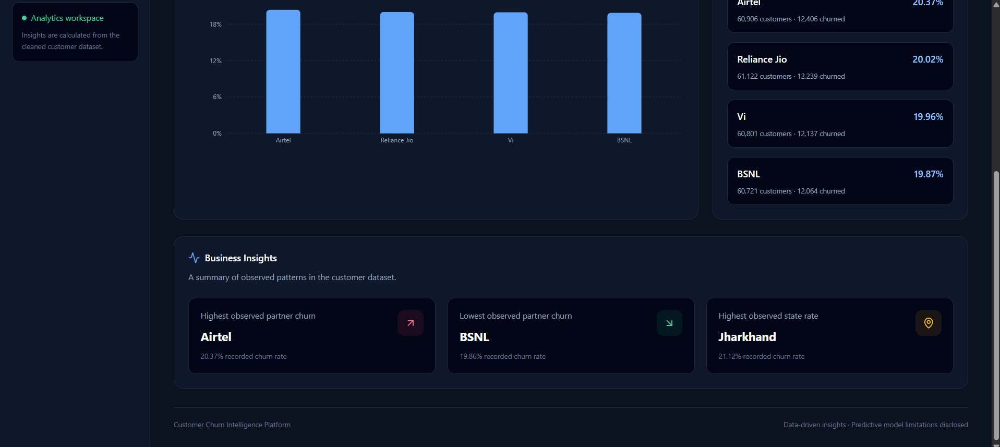

# Aveniq — Customer Intelligence Platform

Aveniq is a full-stack customer intelligence platform that combines machine learning, churn prediction, customer analytics, and interactive business dashboards to help identify customer churn risks and understand customer behavior.

> **Important model limitation:** previous validation of the included churn model produced ROC-AUC around 0.50, which is close to random ranking. Do not use its probability as a dependable retention decision. The intelligence assistant deliberately relies on observed aggregate metrics rather than treating this model as reliable.

## Feature set

### Dashboard and analytics
- Overall customer, churned-customer, retained-customer and observed churn-rate KPIs.
- Partner, state, city, gender, age-group, tenure and usage analysis.
- Business Insights with partner/state filters, sample counts, and highest/lowest observed rates.
- Paginated customer directory, search and churn filters.
- CSV customer import through Spring Boot with validation.

### Churn prediction demo
- Existing trained scikit-learn pipeline and customer-level prediction form.
- Model reliability status and user-facing limitation note.
- Model artifact preserved at `models/churn_model.joblib`.

### AI Intelligence workspace
- **Conversational analyst:** supported questions about customer counts, observed churn rates and partner/state/city/gender comparisons. Answers are calculated from current customer data.
- **Optional LLM wording:** set `OPENAI_API_KEY` and optionally `OPENAI_MODEL` to enable OpenAI-compatible wording over aggregate metrics only. Without a key, deterministic answers work without external AI access. Provider failures fall back to deterministic answers.
- **Controlled investigations:** analyze an all-customer or filtered partner/state segment; view sample sizes, findings, usage summaries, cautious recommendations and limitations.
- **Reports:** export a CSV snapshot of current customer records.
- **Monitoring and alerts:** configure a churn-rate threshold and minimum segment size; checks run periodically and on demand, with local alert history.
- **Automated aggregate reports:** a configurable background job saves low-sensitivity JSON summaries (top partner/state rates and KPIs), never raw customer rows.

The AI assistant does not execute arbitrary SQL or send raw customer rows to an LLM. Its results are descriptive, not causal claims.

## Architecture

```text
React + Vite frontend
   |                         \
   | analytics / prediction  \ customer CRUD / import
   v                           v
FastAPI (port 8003)        Spring Boot (port 8080)
   |                           |
   | approved paginated API    v
   +----------------------> MySQL (churniq_db)
```

FastAPI analytics reads customer records through the shared Spring Boot data loader. The MySQL database must be configured and populated for the complete application to work. The original raw and cleaned CSVs are preserved in this package for development and reproducibility; they are not silently substituted for live database results.

## Project structure

```text
Customer-Churn-Analysis/
├── backend/
│   ├── app/analytics/             # existing analytics and model
│   ├── app/intelligence.py        # grounded AI/insights/report/alert APIs
│   ├── app/business_insights_filtered.py
│   ├── app/main.py
│   ├── requirements.txt
│   ├── requirements-dev.txt
│   ├── .env.example
│   └── tests/test_intelligence.py
├── churniq-backend/backend/       # Spring Boot + JPA + MySQL + CSV import
├── frontend/src/                  # React pages and components
│   └── pages/Intelligence.jsx     # new AI Intelligence workspace
├── data/raw/                      # original CSV
├── data/cleaned/                  # cleaned CSV
├── models/churn_model.joblib
├── notebook/                      # analysis/training/experiment notebooks
├── docs/FEATURE_CHECKLIST.md
└── README.md
```

## Prerequisites

- Python 3.11+ recommended (use a version supported by the pinned scikit-learn release).
- Node.js version compatible with the Vite version in `frontend/package.json`.
- Java 21.
- MySQL Server and a database named `churniq_db`.
- Optional: an OpenAI-compatible API key for LLM-assisted wording.

## Local setup (Windows PowerShell)

Open three terminals from the project root.

### 1. Configure MySQL and Spring Boot

Create the database if it does not already exist:

```sql
CREATE DATABASE churniq_db;
```

Set the database username and password in the same PowerShell terminal before launching Spring Boot. The project no longer includes a hard-coded database password; never commit your local credentials:

```powershell
$env:DB_USERNAME = "root"
$env:DB_PASSWORD = "YOUR_LOCAL_MYSQL_PASSWORD"
# Optional: $env:DB_URL = "jdbc:mysql://localhost:3306/churniq_db"
cd .\churniq-backend\backend
.\mvnw.cmd spring-boot:run
```

JPA is configured to update the schema. Import customer CSV data using the application's CSV upload feature or the existing import API before expecting analytics to return populated results.

### 2. Start FastAPI

From the project root in a separate terminal:

```powershell
python -m venv venv
.\venv\Scripts\Activate.ps1
pip install -r .\backend\requirements.txt
uvicorn app.main:app --app-dir backend --reload --port 8003
```

Swagger docs: <http://127.0.0.1:8003/docs>

If Spring Boot is not at `http://localhost:8080`, set `SPRING_API_URL` to the correct base URL before starting FastAPI.

Optional LLM setup (same FastAPI terminal):

```powershell
$env:OPENAI_API_KEY = "YOUR_API_KEY"
$env:OPENAI_MODEL = "gpt-4o-mini"
```

No key is required for deterministic analyst answers.

### 3. Start React frontend

From a third terminal:

```powershell
cd .\frontend
npm install
npm run dev
```

The Vite terminal prints the local URL. API defaults are defined in `frontend/.env.example`:

```env
VITE_PYTHON_API_URL=http://127.0.0.1:8000
VITE_SPRING_API_URL=http://localhost:8080
```

Set these values in a local `frontend/.env` file only when your API hosts differ. Never put server-side secrets in Vite environment variables.

## API endpoints

Existing analytics endpoints include `/api/summary`, `/api/churn-by-partner`, `/api/churn-by-state`, `/api/churn-by-gender`, `/api/churn-by-city`, `/api/churn-by-age-group`, `/api/churn-by-tenure`, `/api/usage-summary`, `/api/business-insights`, `/api/business-insights/filtered`, `/api/customers`, and `/api/predict`.

New intelligence endpoints:

| Method | Endpoint | Purpose |
|---|---|---|
| `GET` | `/api/intelligence/overview` | Aggregate overview and group rates |
| `POST` | `/api/intelligence/chat` | Grounded analytics question/answer |
| `POST` | `/api/intelligence/investigate` | Filtered segment investigation |
| `GET` | `/api/intelligence/report.csv` | Download customer CSV snapshot |
| `GET` | `/api/intelligence/alerts` | Read alert settings |
| `PUT` | `/api/intelligence/alerts` | Update threshold settings |
| `GET` | `/api/intelligence/alerts/evaluate` | Evaluate current thresholds on demand |
| `GET` | `/api/intelligence/alerts/history` | Read recent manual and scheduled checks |

Full interactive documentation is available at <http://127.0.0.1:8000/docs> while FastAPI is running.

## Tests and validation

Install development dependencies and run the new focused backend tests:

```powershell
pip install -r .\backend\requirements-dev.txt
$env:PYTHONPATH = "backend"
pytest .\backend\tests -q
```

Frontend checks:

```powershell
cd .\frontend
npm run lint
npm run build
```

Also test the full system against the configured local database. Run `python scripts/smoke_test.py` after all three services are running and the database contains customer rows. The automated tests use a small in-memory fixture and do not replace browser-level validation.

## Security and production notes

- Do not commit `.env`, API keys, database passwords, or customer exports.
- The app is a portfolio/demo foundation; add authentication and authorization before exposing customer APIs or reports publicly.
- Alert settings and history are persisted in local files under `backend/runtime/`; use durable storage/backups for multi-instance production deployments.
- Scheduled checks and aggregate snapshots run in the FastAPI process. External notification delivery to email/Slack still requires an explicit integration. Configure cadence with `CHURNIQ_MONITOR_INTERVAL_SECONDS` and `CHURNIQ_AUTO_REPORT_INTERVAL_SECONDS`.
- The churn label definition and time window must be verified before retraining a predictive model.
- Model probabilities should not be used as sole grounds for customer treatment, pricing, or retention decisions.
- See [`docs/FEATURE_CHECKLIST.md`](docs/FEATURE_CHECKLIST.md) for implementation status and remaining deployment checks.

## License

For educational and portfolio purposes unless a separate dataset or dependency license applies. Confirm the source dataset's license before redistribution.


## Local stability notes

- Python dependencies are pinned in `backend/requirements.txt`; install them inside the project virtual environment to keep the serialized scikit-learn model compatible.
- The default FastAPI URL is `http://127.0.0.1:8003`. React can override it with `VITE_PYTHON_API_URL` in `frontend/.env.local`.
- The Intelligence assistant can answer customer-data questions without an external AI key. General-purpose answers use the configured OpenAI-compatible provider and require `OPENAI_API_KEY`; general questions do not require the database to be reachable. Keep secrets out of source control.
- The telecom batch endpoint derives `tenure_months` from the model training snapshot date, not from the current date or each uploaded file's maximum date.
- Use `PROJECT_QA_AND_RUNBOOK.md` for startup commands, endpoint checks, and manual end-to-end validation.


## Dashboard Preview

### Overview



### Business Insights



